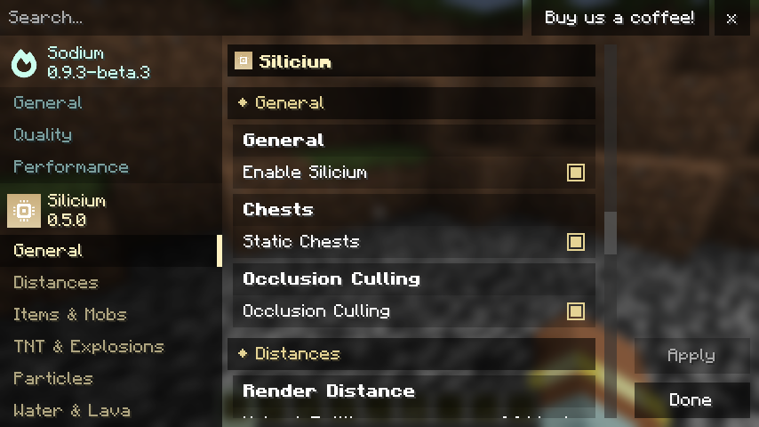

<p align="center"></p>

<h1 align="center">Silicium</h1>

<p align="center">Client-side FPS optimizations for Minecraft (Fabric) — works on any server, no server install needed.</p>

Silicium is designed to run **together with Sodium, Lithium, ImmediatelyFast, EntityCulling** and other
performance mods. It does not touch the graphics API (OpenGL / Vulkan); it removes work the game does on the
CPU and GPU that you can't see anyway.

## Features

- **Static chests** – closed chests (normal, trapped, ender, copper) are baked into the chunk mesh instead of
  being drawn one by one every frame. The opening animation still works.
- **Occlusion culling** – entities and block entities hidden behind solid blocks are skipped (computed on a
  background thread; automatically disabled when EntityCulling is installed).
- **Mob animation LOD** – distant mobs refresh equipment / name tags less often; movement stays smooth.
- **Crowd limits** – only a few dropped items, XP orbs, mobs, primed TNT and falling blocks are drawn per block
  (mob farms, TNT/sand cannons) – stable selection, no flickering.
- **Render distances** per type – mobs, items, item frames & map walls, armor stands, chests/signs/banners,
  moving pistons, particles.
- **Opaque water** – waterfalls (or all water) drawn in the solid layer; water near you stays see-through.
- **Effect limits** – explosions, particle cap, lava/water/drip effects, bubble columns, falling leaves, biome
  particles, random block effect density.
- **Settings** – a tab in Sodium's video settings (Sodium 0.8+), or the *Silicium...* button in the Options menu /
  Mod Menu on older versions.

<p align="center"></p>

## Supported versions

| Minecraft | Silicium |
|---|---|
| 1.20 – 1.20.6 | 0.1.0 – 0.1.6 |
| 1.21 – 1.21.11 | 0.2.0 – 0.2.11 |
| 26.1 – 26.1.2 | 0.3.0 – 0.3.2 |
| 26.2 | 0.4.0 |
| 26.3 | 0.5.0 |

Requires Fabric Loader and Fabric API. Sodium is optional (recommended).

## Building

All versions are built from one source tree in `src/`. Version differences are marked with preprocessor
comments (`//#if MC >= 1.21.2 … //#else … //#endif`), and every Minecraft version has its own
`versions/<mc>/gradle.properties`.

```bash
./gradlew build                                  # all versions -> build/libs
./gradlew build -Psilicium.versions=26.3,1.21.11 # only some versions
./gradlew :26.3:runClientGameTest                # in-game test (dedicated server)
./gradlew :1.20.1:prodSelfTest                   # mixin self-test in a production game
```

## Support

- Bugs and ideas: [GitHub Issues](https://github.com/hubileja1/silicium/issues)
- Discord: **hubilsupport**
- E-mail: [hubil.support@gmail.com](mailto:hubil.support@gmail.com)

## License

[MIT](LICENSE)
